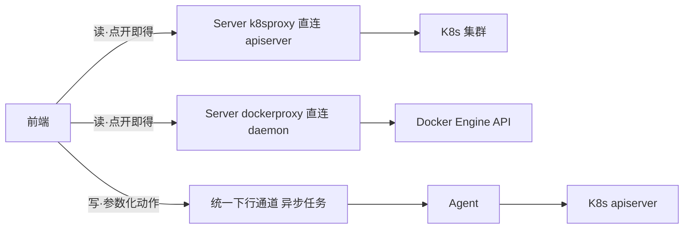

# 容器与工作负载管理面详细设计（信息架构重规划）

日期：2026-10-10
状态：**已实施（二版）**。一版只产出规划；二版按用户拍板把数据通路改为「Server 直连」，代码已落地。
上位文档：`2026-09-30-ops-platform-evolution-design.md`（总体设计）、`2026-09-30-ops-platform-capability-map.md`（功能全景对照表 §3.8）
决策记录：`docs/adr/0003-container-management-downlink.md`（异步下行）、`docs/adr/0004-k8s-live-proxy.md`（Server 侧实时查询）、`docs/adr/0005-docker-management-channel.md`（**已被取代**）、`docs/adr/0006-direct-api-for-container-management.md`（二版选定）
相关设计件：`2026-09-30-container-observability-design.md`（D3，容器管理面）、`2026-10-04-container-inventory-design.md`（容器/工作负载台账清单）

## 二版修订（2026-10-10，已实施）

一版把**数据通路**判断错了，二版按用户拍板改正。下面四条取代一版对应内容：

| # | 一版的判断 | 二版的实际做法 |
|---|---|---|
| 1 | Docker「不存在 Server 直连等价通路」，全部能力（含只读）走 Agent 异步下行 | **Docker 读写都 Server 直连 daemon**。`DockerInstanceConfig.Addr` 本来就允许 `tcp://host:2375`（网络可达），与 apiserver 地址没有本质差别；ADR-0004 那句「点开即得」对它同样成立。见 ADR-0006 |
| 2 | K8s 只读走 Server 代理，但**与异步下行并存**（5 个 `container.*` 只读动作保留） | **删掉那 5 个只读动作**，K8s 读只留一条直连通路。两条通路并存会让人分不清自己看到的是哪一条，而慢的那条只会让人以为平台卡 |
| 3 | Docker 端点清单由运维在 Server 上另配一份 | **复用 Agent 上报**的端点（`dockerEndpoints`，含 daemon 地址）。代价是地址离开 Agent 本机；收益是运维不必维护两份配置 |
| 4 | Docker 写操作另设本机护栏 `guards.ops.docker{read,write}` | **该护栏已删除**：直连之后 Agent 侧没有执行点，护栏无处安放。写操作的门控 = `docker:write`（仅超管）+ 界面二次确认 + 审计 |

一版判断错的根因值得记下来：把「地址只在 Agent 本机」当成了**架构事实**，而它其实只是**默认部署形态**——`Addr` 从一开始就允许 tcp。K8s 那边同样的事（凭据在 Agent 本地）被 ADR-0004 正确地处理成「运维在 Server 上另配一份」，Docker 却被判成「无解」，两者不一致。

因此一版的这些小节的结论已过时，**以本节的二版说法为准**：§3.3、§4.1（kind 清单）、§4.2（本机护栏）、§6（接口草案）、§9（分批）。§2.3 的「实时态口径」与 §八 的取舍说明也按二版更新。

## 意图与边界

**意图**（一条主线，两个菜单）：

把「由 Agent 采集、进时序库的**指标**」与「需要额外查询/下发才能得到的**对象事实与操作**」彻底分开，各自只留一个归属：

1. **中间件监控 → Kubernetes / Docker Tab**：只做**指标展示**——聚合计数与用量曲线，粒度到「集群 / 节点 / 主机」；对象级明细一律移除，只留跳转入口。
2. **容器与工作负载**：做**对象级管理**——覆盖 Kubernetes 与 Docker 两个平台；K8s 在既有只读面上新增排障写操作，Docker 从零建立管理面。

**边界**：

- **不提供任意命令 / 终端**。所有管理能力都是**参数化动作**（动作白名单 + 参数正则校验），这是平台操作面的既定上限（2026-10-05 用户拍板），本设计不打开这条口子。`container.exec` 仍为 P2、需独立评估。
- **凭据边界按通路分**。K8s 凭据只在 Agent 本地（`k8sInstances`）与 Server 侧直连配置（`k8s-live.yaml`）两处，**K8s 写操作只走 Agent 异步下行**；Docker 的 daemon 地址随上报进入 Server（这是「管理面要实时」的直接代价，见 §二版修订 3），**只在 Server 内部使用、不进任何响应体**。
- **写操作的门控按通路分**。K8s 写仍走异步下行，因此保留 Agent 本机护栏 `guards.ops.containerWrite`；Docker 写是 Server 直连，本机护栏无处安放，门控 = `docker:write`（仅超管）+ 界面二次确认 + 审计。
- **一版只出文档、二版已实施**。一版评审通过后按 §九 分批落地；二版按上面的「二版修订」改正数据通路。

## 现状与依据

| 事实 | 依据 |
|---|---|
| 两个菜单各自独立 | `web/src/router/index.js:32`（middleware，`middleware:read`）、`:36`（container，`container:read`）；`web/src/components/Sidebar.vue:169,171` |
| 中间件 K8s Tab 是「指标 + 对象明细」混合 | `web/src/components/k8s/K8sTab.vue`：KPI 第 25-44 行、集群卡片第 47-81 行、节点列表第 84-104 行、**异常 Pod 明细第 107-124 行**；接口 `GET /api/v1/middleware/k8s/instances`（第 190 行） |
| 中间件 Docker Tab 也是混合 | `web/src/components/docker/DockerTab.vue`：KPI 第 24-43 行、实例拓扑第 45-62 行、**容器列表第 64-116 行 + 详情抽屉第 119-152 行**；接口 `GET /api/v1/middleware/docker/containers`（第 233 行）、趋势 `GET /api/v1/query/range`（第 286-288 行） |
| 容器页只有 K8s、无 Docker | `web/src/components/container/ContainerView.vue`；4 个 Tab（第 290-296 行）为 `container.workloads` / `container.pods` / `container.events` / 实时清单（Server 代理） |
| 动作目录是新增动作的唯一入口 | `internal/server/ops/catalog.go:96-193`；kind 字面量统一定义在 `internal/model/ops.go:26-47`（Server 与 Agent 共用，不能各写一份） |
| **容器分组被守卫断言为「不得含写动作」** | `internal/server/ops/catalog_test.go:269-299` `TestCatalog_ContainerGroupIsReadOnlyAndGroupOrderStable`：容器分组内不得出现写动作、每个动作的 `Group` 必须在 `groupOrder` 声明 |
| 本机护栏结构 | `internal/agent/config/config.go:99-123` `OpsGuards{ReadOnly *bool, Write bool, Units []string, Container *bool, File OpsFileGuards}`；`OpsContainerEnabled()` `:174-176`（默认放行）；**无任何 docker 字段** |
| 能力协商只列「本机放行」的动作 | `internal/agent/ops/executor.go:85-106` `Supported()`；上报装配 `cmd/agent/main.go:454-461`（`Capabilities.Ops`） |
| K8s 实时代理是纯 GET | `internal/server/k8sproxy/k8sproxy.go:155-188`（唯一外呼 `GetJSON`，`http.MethodGet`）；白名单 `internal/server/api/k8s_live.go:23-28`（pods/deployments/events/nodes） |
| Docker 采集是纯只读，且已具备管理所需的端点雏形 | `internal/agent/collector/docker.go`：`GET /containers/json?all=true`（`:252-263`）、`GET /images/json`（`:265-276`）、`GET /containers/{id}/stats?stream=false`（`:278-289`）；全文件无 POST/DELETE |
| Docker 实例配置 | `internal/model/metric.go:530-533` `DockerInstanceConfig{Name, Addr}`（`Addr` 形如 `unix:///var/run/docker.sock` 或 `tcp://host:2375`）；`internal/agent/config/config.go:46` |
| 权限点目录 | `internal/server/auth/model.go:355-391`；「容器」域当前只有 `container:read`（`:384-387`） |
| 高风险权限点实际 11 项 | `internal/server/auth/policy.go:187-206`；**注意** `docs/guides/permission-matrix.md:37,434` 仍写「8 个 / `policy.go:71`」，是 1.25.0 基线快照，已过期，本批一并更正 |
| 权限点覆盖守卫 | `internal/server/auth/catalog_test.go:119-138` `TestEveryCatalogKeyIsGrantedBySomeRole`（每个权限点必须有非超管内置角色覆盖，例外须进 `superAdminOnlyKeys`） |
| 视图开关（Tab 显隐） | `internal/server/api/middleware_view_api.go` + `internal/server/mwview/store.go`；路由 `internal/server/api/query.go:298-301` |
| 术语现状 | `CONTEXT.md:127-159`（工作负载 / 容器 / 短命资产 / 下行操作 / 高危操作护栏 / **容器只读管理面**） |

## 一、职责定界

### 1.1 定界规则（一句话可判定）

> **中间件 Tab 回答「有多少 / 用了多少」（聚合计数与用量，维度止于集群 / 节点 / 主机）；
> 容器与工作负载回答「是哪个 / 它怎么样 / 对它做什么」（对象事实与操作，粒度到工作负载 / Pod / 容器 / 镜像）。**

推论（用于判断边界上的争议项）：

- 一个数字若**在时序库里有对应指标**且**不需要再查一次对象**就能算出来 → 归指标面。
- 一条信息若**包含对象标识**（对象名、命名空间、容器 ID、重启次数、原因）→ 归对象面，**哪怕它的数据源是指标**（例如「异常 Pod 明细」：计数是指标，明细是对象事实）。
- 一个按钮若会**改变被管理对象的状态** → 只能出现在容器与工作负载，且必须是参数化动作。

### 1.2 定界表

**A. 指标面（留在「中间件监控」）**

| 功能点 | 数据源 | 权限点 | 现状 | 目标 |
|---|---|---|---|---|
| K8s 集群健康（集群数、版本、在线） | 时序库 `k8s_cluster_up` + `instancereg` | `middleware:read` | K8sTab 集群卡片 | 保留（纯展示） |
| K8s 节点就绪 / 总数 | 时序库 `k8s_node_*` | `middleware:read` | K8sTab KPI | 保留 |
| K8s 节点 CPU / 内存用量 | 时序库 `k8s_node_cpu_usage_cores` / `k8s_node_mem_usage_bytes` | `middleware:read` | K8sTab 节点列表 | 保留（指标按节点展开，见 §1.4 争议项①） |
| Pod 运行 / 总数 / 异常计数 | 时序库 `k8s_pods_running` / `k8s_pods_abnormal` | `middleware:read` | K8sTab KPI | 保留 |
| 不健康工作负载计数 | 时序库 | `middleware:read` | K8sTab KPI | 保留 |
| Docker 主机 / 容器 / 镜像计数 | 时序库 `docker_*` | `middleware:read` | DockerTab KPI | 保留 |
| Docker 实例拓扑（按主机聚合计数） | 时序库 | `middleware:read` | DockerTab 实例拓扑 | 保留（聚合口径，不含容器明细） |
| **K8s 异常 Pod 明细** | 时序库即时查询 | `middleware:read` | K8sTab 第 107-124 行 | **移除**，改为跳转 |
| **Docker 容器列表 + 详情抽屉** | 时序库 + `/query/range` 趋势 | `middleware:read` | DockerTab 第 64-152 行 | **移除**，改为跳转 |

**B. 对象面（收敛到「容器与工作负载」）**

| 功能点 | 数据源 | 权限点 | 现状 | 目标 |
|---|---|---|---|---|
| K8s 可选集群清单 | `GET /api/v1/container/k8s/clusters` | `container:read` | 容器页 | 保留为管理面唯一「集群选择器」来源 |
| 工作负载列表 / 详情 | 异步 `container.workloads` / `container.describe` | `container:read` | 容器页 | 保留 |
| Pod 列表 / 详情 | 异步 `container.pods` / `container.describe` | `container:read` | 容器页 | 保留 |
| 事件 | 异步 `container.events` | `container:read` | 容器页 | 保留 |
| 实时清单 | Server 代理 `k8s_live`（只读白名单） | `container:read` | 容器页 | 保留（白名单不外扩） |
| Pod 日志（按需） | 异步 `container.logs` | `container:read` | 容器页 | 保留 |
| **重启工作负载 / 扩缩容 / 删除 Pod** | 新增 `container.restart` / `container.scale` / `container.delete` | **`container:write`（新）** | 无 | 新增（§四） |
| **Docker 引擎概览** | 新增 `docker.info` | **`docker:read`（新）** | 无 | 新增 |
| **Docker 容器列表（实时态）** | 新增 `docker.containers` | `docker:read` | 无 | 新增 |
| **Docker 容器详情 inspect** | 新增 `docker.inspect`（白名单投影） | `docker:read` | 无 | 新增 |
| **Docker 容器日志** | 新增 `docker.logs` | `docker:read` | 无 | 新增 |
| **Docker 容器启停 / 重启 / 删除** | 新增 `docker.start` / `docker.stop` / `docker.restart` / `docker.rm` | **`docker:write`（新）** | 无 | 新增 |
| **Docker 镜像列表 / 删除** | 新增 `docker.images` / `docker.image.rm` | `docker:read` / `docker:write` | 无 | 新增 |

### 1.3 中间件 Tab 收窄清单（逐块）

**`web/src/components/k8s/K8sTab.vue`**

| 块 | 行号 | 处置 | 说明 |
|---|---|---|---|
| 页头「展示类型开关」 | — | 保留 | 由 `middleware/view-config` 控制 |
| KPI 卡 | 25-44 | 保留 | 「异常 Pod」卡改为**可点击**，跳容器与工作负载并带上集群/命名空间预筛 |
| 集群卡片 | 47-81 | 保留 | 纯指标（版本、节点/Pod 计数、异常数） |
| 节点列表 | 84-104 | 保留 | 指标按节点展开（CPU/内存用量）；见 §1.4 争议项① |
| **异常 Pod 明细** | 107-124 | **移除** | 对象事实（Pod 名、命名空间、原因、重启次数）；移除后由 KPI 卡跳转承接 |
| 页头「进入容器与工作负载」 | — | **新增** | 跳 `/container`（按当前集群预筛） |

**`web/src/components/docker/DockerTab.vue`**

| 块 | 行号 | 处置 | 说明 |
|---|---|---|---|
| KPI 卡 | 24-43 | 保留 | 主机总数 / 在线 / 容器总数 / 运行中 / 已停止 / 镜像数 |
| 实例拓扑（按主机） | 45-62 | 保留 | 聚合口径；卡片上可加「进入 Docker 管理」入口 |
| **容器列表** | 64-116 | **移除** | 对象事实（容器名、镜像、状态、CPU/内存），改由 Docker 管理面承接 |
| **容器详情抽屉** | 119-152 | **移除** | 含 `GET /api/v1/query/range` 趋势调用（第 286-288 行），一并从该页移除 |
| 页头「进入容器与工作负载 → Docker」 | — | **新增** | 跳 `/container`（切到 Docker 平台） |

> 移除后，`DockerTab.vue` 不再调用 `GET /api/v1/middleware/docker/containers` 的明细字段与 `/query/range`；接口本身**保留不动**（它同时供总览与其它消费方，且是 `middleware:read` 的指标视图）。是否精简其响应字段留待实施时评估，本设计不主张改接口。

### 1.4 重叠消解与三处争议项

**消解①：集群清单两条接口——保留，但明确职责（刻意不合并）。**

`internal/server/api/container_api.go:handleContainerClusters` 与 `internal/server/api/middleware_api.go:handleK8sInstances` 同源（都读 `instancereg` 的 `K8sInstance` + `k8s_cluster_up`），看起来是重复。**结论：不合并。** 理由：

- 两条接口的**权限点不同**（`container:read` vs `middleware:read`）。合并成一条会让「能看指标的人」或「能管容器的人」之一失去入口，或者被迫扩大权限——这正好违反本设计的定界初衷。
- 两条接口的**最小视图不同**：管理面只需要「可选集群名 + 在线」，指标面需要「节点/Pod/工作负载计数」。合一条会让指标页依赖管理面接口，或反之。

**要写进注释/文档的是「同源不冗余」**，避免以后有人以「去重」为名把它们合并掉。

**消解②：Pod 视图两处——中间件侧只留计数，对象入口唯一。**

移除 K8sTab 的异常 Pod 明细后，「看某个 Pod」的唯一入口是容器与工作负载。KPI 上的计数卡保留并作为**下钻入口**（点计数 → 跳到管理页并按集群/命名空间预筛），这样「先看有没有异常、再看是哪个」的动线仍然顺畅。

**消解③：集群/节点视角——两处都保留，但信息面不同。**

中间件 K8s Tab 的节点列表是**指标维度展开**（CPU/内存用量）；容器页的实时 `nodes` 是**管理面对象视图**（实时态、可用于定位 Pod 落在哪台机器）。二者不冲突。

**争议项①：节点列表到底算不算「对象明细」？**

节点列表含节点名 / IP / 集群 / 角色 / 状态，看起来是对象事实。**判定为保留**，理由：这张表的**存在意义是承载 CPU/内存用量两列**（metrics-server 的数据源，见 `reference_dev_server_k8s.md` 的教训：裁掉 metrics-server 会让这两列静默显示 `-`），不是「管理节点」。定界规则里「指标按节点展开」明确允许它。**若将来要给它加操作按钮（cordon / drain），那必须移到管理面**——这条写进注释。

**争议项②：Docker 实例拓扑算不算对象明细？**

`DockerTab` 的实例拓扑按**主机**聚合（每主机一个卡片 + 容器计数），粒度止于主机，符合「维度止于主机」。**保留**。容器级的列表才移除。

**争议项③：Docker 容器数按主机 vs 容器列表。**

保留「按主机的容器计数」，移除「跨主机的容器明细列表」。二者粒度不同，前者是聚合，后者是对象。

## 二、「容器与工作负载」新信息架构

### 2.1 顶层结构

页面顶部为**平台切换**（Kubernetes / Docker），之下按「资源类型 → 对象 → 详情 / 事件 / 日志」组织，沿用既有抽屉、表格、「上次刷新」与「提交 → 轮询」约定，**不新建前端框架**。

```
容器与工作负载  [ Kubernetes | Docker ]
├─ Kubernetes
│   ├─ 集群选择 + 命名空间
│   ├─ 工作负载   列表 / 详情 / [重启] [扩缩容]
│   ├─ Pod        列表 / 详情 / [删除] / 日志
│   ├─ 事件
│   └─ 实时清单   （Server 只读代理）
└─ Docker
    ├─ 主机选择（Docker 引擎）
    ├─ 引擎概览   版本 / 容器与镜像计数 / 资源占用
    ├─ 容器       列表 / 详情 inspect / 日志 / [启停] [重启] [删除]
    └─ 镜像       列表 / [删除]
```

平台切换用**独立状态**（切到 Docker 不应丢掉 K8s 的查询结果）；`web/src/components/container/queryCache.js` 的跨路由保留语义沿用。

### 2.2 Kubernetes 侧

在既有 4 个 Tab 上新增写操作入口（按钮按权限门控 + 二次确认）：

| 操作 | 语义 | 对应动作 | 备注 |
|---|---|---|---|
| 重启工作负载 | `kubectl rollout restart` 等价 | `container.restart` | 参数：集群、命名空间、kind、名称 |
| 扩缩容 | 修改副本数 | `container.scale` | 参数：集群、命名空间、kind、名称、replicas（有上下限） |
| 删除 Pod | 删除单个 Pod（由控制器重建） | `container.delete` | 参数：集群、命名空间、Pod 名 |

**不做**：删除工作负载、删除命名空间、`kubectl exec`、任意 YAML apply/patch。删除工作负载是「不可逆的破坏」，与「排障」不是一类；`apply` 是任意配置写入，等价于绕过白名单。

### 2.3 Docker 侧（全新）

| 区域 | 能力 | 接口（二版：Server 直连） |
|---|---|---|
| 端点选择 | 选择 Docker 端点（来自 Agent 上报的 `DockerEndpoint`，定位二元组是 node + name） | `GET /container/docker/endpoints` |
| 引擎概览 | 版本、容器/镜像计数、CPU/内存/磁盘 | `GET /container/docker/info` |
| 容器列表 | 状态、镜像、端口、启动时间 | `GET /container/docker/containers?all=` |
| 容器详情 | 白名单投影的 inspect（见 §4.3） | `GET /container/docker/containers/{id}` |
| 容器日志 | stdout/stderr 最近 N 行 | `GET /container/docker/containers/{id}/logs` |
| 容器启停 | start / stop / restart | `POST /container/docker/containers/{id}/{start\|stop\|restart}` |
| 容器删除 | 删除容器（默认不删卷，见 §八） | `DELETE /container/docker/containers/{id}` |
| 镜像列表 | 仓库标签、大小、创建时间、悬空标记 | `GET /container/docker/images` |
| 镜像删除 | 删除镜像 | `DELETE /container/docker/images/{id}` |

**实时态口径（二版改正）**：Docker 全部能力走 **Server 直连 daemon**（§3.3），因此「实时态」就是**点开即得**。界面仍显示查询时间，但那是一句如实的说明（"这份快照是几点取的"），**不是"等了一个上报周期"的免责声明**。

**唯一要写在界面上的形态约束**：daemon 地址必须是 Server 够得着的。unix socket 只在同机时可用，跨机器要把 daemon 暴露为 `tcp://`（或挂 socket 代理）——不可达时服务端给出的正是这句可执行的提示（见 `dockerproxy.dialError`）。

## 三、数据通路（二版）



| 能力 | 通路 | 为什么 |
|---|---|---|
| K8s 读（工作负载 / Pod / 事件 / 详情 / 日志） | **Server 直连 apiserver**（`internal/server/k8sproxy/`，凭据来自 `k8s-live.yaml`） | 「点开即得」（ADR-0004） |
| K8s 写（重启工作负载 / 扩缩容 / 删除 Pod） | 异步下行（ADR-0003） | 要逐机护栏与 Agent 本地的集群凭据 |
| Docker 读（端点 / 概览 / 容器 / 镜像 / 详情 / 日志） | **Server 直连 daemon**（`internal/server/dockerproxy/`，端点来自 Agent 上报） | 同 K8s 读；ADR-0005 判「无解」是错的（见二版修订 1） |
| Docker 写（启停 / 重启 / 删除容器、删除镜像） | **Server 直连 daemon**（同上） | 用户 2026-10-10 拍板「读写都直连」：实时性优先，接受「Server 侧持有能启停容器的能力」这个代价 |

**读为什么必须直连（而不是"直连也行、异步也行"）**：异步下发的延迟等于一个上报周期。对"看指标"无所谓，对"看清单再动手"很要紧——人要先看到容器在跑、才决定停哪一个，中间隔十几秒就意味着看到的状态可能已经变了。ADR-0004 为 K8s 定的就是这条。

**K8s 只留一条读通路**：一版让直连代理与 5 个异步只读动作并存。两条路都能给出「工作负载列表」，但一条是当前态、一条是十几秒前的快照，而界面上分不出来——这种「多一条路」的退化不会报错，只会让人越来越不信界面上的数字。因此二版把那 5 个动作删了。

**两条直连通路的形态差异（别当成不一致）**：

- K8s 的凭据由运维在 Server 上**另配一份**（`k8s-live.yaml`）——集群凭据（token/kubeconfig）确实不该离开它被配置的地方；
- Docker 的端点**复用 Agent 上报**——daemon 地址不是凭据（能启停容器靠的是 daemon 的访问控制，不是地址的保密），另配一份只会让运维维护两处、且必然对不上。

这条差异是有意的，不是漏改。

## 四、动作清单与护栏

### 4.1 动作清单（二版：只剩 K8s 写操作）

kind 字面量统一加在 `internal/model/ops.go`（Server 与 Agent 共用），目录登记在 `internal/server/ops/catalog.go`，Agent 分派在 `internal/agent/ops/`。

| kind | 分组 | 只读 | 所需域权限点 | 参数（正则/上限） |
|---|---|---|---|---|
| `container.restart` | 容器操作 | 否 | **`container:write`（仅超管）** | cluster、namespace、kind、name |
| `container.scale` | 容器操作 | 否 | **`container:write`（仅超管）** | cluster、namespace、kind、name、replicas（0 ~ 上限，整数） |
| `container.delete` | 容器操作 | 否 | **`container:write`（仅超管）** | cluster、namespace、pod |

**Docker 的 10 个动作与 K8s 的 5 个只读动作已全部删除**（ADR-0006）：

- Docker 那 10 个（`docker.info/containers/inspect/logs/images` + `docker.start/stop/restart/rm/image.rm`）改由 `internal/server/dockerproxy/` 的同步接口承担；
- K8s 那 5 个（`container.workloads/pods/describe/events/logs`）改由 `internal/server/k8sproxy/query.go` 承担；
- 删除后「容器」「Docker」「Docker 操作」三个分组随之清空。目录里**不留没有动作的分组**——那会让界面上出现一个点不开的标签页。`groupOrder` 收敛为 `节点 / 服务 / 容器操作 / 文件`；
- 有一条守卫专门钉住「它们不得回来」：`internal/server/ops/catalog_removed_actions_test.go`。

> 「所需域权限点」这一列是 **D4** 的落地形态：写在动作目录的 `Action` 上，提交时统一校验——**新增动作只改目录一处**。Docker 的权限点不走这里，它们由路由层的 `a.permit` 表达（`internal/server/api/query.go`）。

**分组命名与既有守卫**：`catalog_test.go` 断言「容器分组内不得出现写动作」且每个 `Group` 都必须在 `groupOrder` 中声明。二版之后「容器」分组已不存在，那条断言不再约束任何东西——它守的承诺（容器只读）已经由「容器只读动作根本不在目录里」更强地表达了。

### 4.2 本机护栏（二版：只剩 K8s 写那一道）

沿用四道护栏（本机护栏 → 能力协商 → 中心授权与审计 → 超时作废）：

```yaml
guards:
  ops:
    containerWrite: true   # K8s 排障写操作（重启工作负载 / 扩缩容 / 删除 Pod）。默认 false
```

- **`guards.ops.docker.{read,write}` 已删除**：直连之后 Agent 侧没有执行点，护栏无处安放；留着它就是一个看起来能用、实际什么都不挡的**空开关**（比没有更坏——运维会以为自己挡住了一件其实挡不住的事）。
- **`guards.ops.container`（只读开关）同样删了**：K8s 读改由 Server 直连，本机再留一个只读开关只会误导。
- 存量配置里的 `container:` / `docker:` 键会被解析器忽略（不报错）。升级后**行为不变**，但运维该知道那两个键已经不起作用了。
- **能力协商**：`Supported()` 只列本机放行的动作（`internal/agent/ops/executor.go` 的既有做法）。未开 `containerWrite` 的机器**不声明** `container.*` 写能力，界面显示「该节点未放行」，而不是下发一条注定失败的任务。

**Docker 写操作的门控换成了什么**（必须写清楚，因为它少了一道门）：一版是「权限点 + 逐机护栏 + 二次确认 + 审计」四道；二版直连之后逐机护栏不存在了，剩下三道——`docker:write`（仅超管）、界面二次确认、审计。这不是"忘了补"，而是**用户明确选了实时性**：Server 侧配置里确实因此持有「能启停容器」的能力，中心被攻破即全网容器可被启停。把这条代价写在 ADR-0006 里，比藏在护栏清单里好。

### 4.3 脱敏与上限

**`docker.inspect` 是白名单投影，不是原始 JSON**（与 `container.describe` 同一条道理：脱敏透出漏一个字段就是一次凭据泄露）：

| 字段类 | 处置 |
|---|---|
| 环境变量 | 只给**变量名**，不给值 |
| 挂载（Mounts / Binds） | 给宿主路径与容器路径，不给内容 |
| 网络（NetworkSettings） | 给网络名、IP、端口映射；不给完整 JSON |
| 标签 / 注解 | 白名单键（`com.docker.compose.*` 等），其余略过 |
| `Config.Env` / `Config.Labels` 中的凭据类键 | 一律占位符 |
| `Config.Image` / `Image` | 给（排障必需） |

**`docker.logs`**：行数默认 200 / 最多 500，时间窗最多 24h，单次正文预算与 `container.logs` 同口径（96 KiB），超出即截断并显式标注；**不提供全量下载**（与 `container.logs` 一致：要看全量应上机器或走日志后端）。

### 4.4 结果形态（二版）

**所有容器查询（K8s 与 Docker）都复用 `model.ContainerQueryResult`**（列名 + 行的通用表格形态）——包括 `inspect` / `describe` 这类"详情"：它们也是两列（字段 / 值）的表，前端因此只需要一套渲染代码。

一版曾写「`docker.inspect` 用 `OpsResult.JSON`」，那是异步下行的产物（结构化载荷得搭在回执里）；二版直连之后没有回执，直接返回同一个结构。**前端与用例因此几乎不用改**——这也是选这个形态的理由之一。

## 五、权限点与角色

### 5.1 新增权限点

| 域 | 权限点 | 说明 | 授予 |
|---|---|---|---|
| 容器 | `container:write` | K8s 排障写操作：重启工作负载 / 扩缩容 / **删除 Pod** | **仅超管**（`superAdminOnlyKeys`） |
| 容器 | `docker:read` | Docker 管理面只读（引擎概览 / 容器列表 / 详情 / 日志 / 镜像列表） | 运维管理员 |
| 容器 | `docker:write` | Docker 写操作（启停 / 重启 / 删除容器、删除镜像） | **仅超管**（`superAdminOnlyKeys`） |

**为什么 K8s 三项写操作合成一个权限点（而不是拆成两个）**：初稿曾把「删除 Pod」单列，理由是重启/扩缩容有控制器兜底、删除没有。用户 2026-10-10 拍板**三项全部只给超管**之后，这个拆分就不再表达任何差异——两个权限点会**永远同时授予**（只有超管有），等于一个权限点加一份噪声。**权限点的价值在于能表达一个独立的授权判断**，表达不了就该合并。若将来出现「让运维管理员能重启、但只有超管能删」的真实诉求，那时再拆（改动很小：加一个权限点 + 两处登记）。

**为什么不把 Docker 并进 `container:read`**：Docker 管理面读的是**本机（或可达网段）的容器运行时**，K8s 管理面读的是**集群内部对象**——两者的授权面不同（一台机器可能只跑 Docker 不接集群，反之亦然）。这延续 `container:read` 与 `middleware:read` 分开的同一取舍。

### 5.2 高风险与双人复核（已定）

- 两个**写**权限点（`container:write` / `docker:write`）均**改变被管理对象的状态**，**并入 `HighRiskPermissions`**（`internal/server/auth/policy.go:187-206`）。`docker:read` 是只读，不入。
- **双人复核（D1）：不纳入**（用户 2026-10-10 拍板）。与 `ops:exec` 当前口径一致——`IsHighRisk` 目前是**声明式标记**（不额外拦截），待审批链路真正拦截后再统一收口。因此本设计的门控是「权限点 + 本机护栏 + 界面二次确认 + 审计」四件，**不依赖审批链路**。

### 5.3 内置角色授予（已定）

必须满足 `TestEveryCatalogKeyIsGrantedBySomeRole`（`internal/server/auth/catalog_test.go:119-138`）：每个权限点都要有**非超管**内置角色覆盖，否则必须进 `superAdminOnlyKeys` 并注明理由。

| 权限点 | 授予 | 依据 |
|---|---|---|
| `container:write` | **仅超管**（进 `superAdminOnlyKeys`） | 用户 2026-10-10 拍板：K8s 三项写操作（重启工作负载 / 扩缩容 / 删除 Pod）全部只给超管 |
| `docker:read` | 运维管理员 | 只读，与 `container:read` / `logs:read` 同一取舍 |
| `docker:write` | **仅超管**（进 `superAdminOnlyKeys`） | 用户 2026-10-10 拍板：启停 / 删除容器与删除镜像直接改变本机运行态 |

**刻意不给只读 / 告警 / 安全 / 审计角色**：与 `container:read` / `logs:read` / `ops:exec` 的既有取舍一致。

**与既有取舍的一处刻意偏离（实施时写进注释）**：两个写权限点**都没有**沿用「给运维管理员、靠本机护栏兜底」这条对 `ops:exec` 的惯例——用户明确要求只给超管。二版之后两者的门控层数不同：**K8s 写**是两道门（权限点 + Agent 本机护栏 `guards.ops.containerWrite`），**Docker 写**只有一道（权限点）——直连之后 Agent 侧没有执行点，那道本机护栏已删除。若将来运维反馈「重启容器 / 工作负载也得用超管账号」成为负担，再评估放宽（改动只在 `BuiltinRoles()` 与 `superAdminOnlyKeys` 两处）。

## 六、接口（二版：实际落地的形态）

```
# 只读（全部 Server 直连，同步返回；权限点见行尾）
GET    /api/v1/container/k8s/clusters                          # 集群清单（container:read）
GET    /api/v1/container/k8s/live-configs                      # Server 侧配了直连凭据的集群名（container:read）
GET    /api/v1/container/k8s/live/{cluster}/{cap}              # cap ∈ workloads|pods|events|object|logs（container:read）
GET    /api/v1/container/docker/endpoints                      # 端点清单（docker:read）——**不含 daemon 地址**
GET    /api/v1/container/docker/info                           # 引擎概览（docker:read）
GET    /api/v1/container/docker/containers                     # 容器列表（docker:read）
GET    /api/v1/container/docker/containers/{id}                 # 容器详情（白名单投影，docker:read）
GET    /api/v1/container/docker/containers/{id}/logs            # 容器日志（docker:read）
GET    /api/v1/container/docker/images                          # 镜像列表（docker:read）
# 写
POST   /api/v1/container/docker/containers/{id}/{start|stop|restart}   # docker:write（仅超管）
DELETE /api/v1/container/docker/containers/{id}                        # docker:write（仅超管）
DELETE /api/v1/container/docker/images/{id}                            # docker:write（仅超管）
POST   /api/v1/ops/tasks                                        # K8s 写操作仍走这里（ops:exec + container:write）
```

**Docker 端点用 (node, name) 二元组定位**，不是只用 name：`dockerInstances[].name` 是每台机器各自起的名，不同机器上叫同一个名字完全可能（都叫 "local"）。只按 name 找会命中错的那台机器，而「在 A 机器上停掉了 B 机器的容器」是这类接口最不能犯的错。

**地址不进响应体**：`/docker/endpoints` 只返回 node / name / reachable / unixSocket，**不返回 daemon 地址**。地址随上报到了 Server（见二版修订 3），但不该再往浏览器走一步——它只在 Server 内部用于直连。

**K8s 的 `{cap}` 是能力名而不是资源名**：能查什么由白名单钉死（`k8sLiveCaps`），换个资源名试不出来。列表 / 单对象 / 子资源三种层级因此收敛成同一条路由族，而不是一版设想的三条并列模式。

**权限点如何按 kind 判定（D4，已定）**：`POST /ops/tasks` 的既有入口权限点是 `ops:exec`。本设计**不改变**这条通道的入口权限（改它会波及全部动作），而是在**动作目录的 `Action` 结构体上增加 `Perm` 字段**——每个动作自带「除 `ops:exec` 之外还需要哪个域权限点」，提交时统一校验：

- `container.restart` / `container.scale` / `container.delete` → `container:write`（仅超管）

Docker 的权限点**不走这条通道**（它现在是直连接口），由路由层的 `a.permit` 表达。

**D4 到底在问什么、三种做法对比**（问的是「服务端在哪一步知道『这个动作需要哪个域权限点』」）：

| 做法 | 结论 |
|---|---|
| **在动作目录的 `Action` 上加 `Perm` 字段**（选定） | 「新增动作只改目录一处」这条既有承诺继续成立（现在新增动作确实只改目录 + Agent 实现）。权限点与动作定义在同一个地方，不会漂移 |
| 在 ops handler 里再写一份 `kind → 权限点` 映射表 | 同一件事两处定义；将来新增动作容易只改目录、漏改映射表，而**漏改的症状是「权限没校验」**——静默放大权限，是最危险的一类遗漏 |
| 给每个动作单开路由 / 单列权限点 | 路由爆炸（13 个新动作），且要重做前端调用与能力协商，收益不成比例 |

## 七、前端与菜单

- **菜单不动**：「容器与工作负载」仍是「观测监控」分组下的一项（`Sidebar.vue:171`），命令面板入口不变。
- **中间件 Tab 加跳转**：`K8sTab.vue` / `DockerTab.vue` 页头新增「进入容器与工作负载」按钮（分别带 `?platform=k8s` / `?platform=docker` 预筛）。
- **容器页加平台切换**：`ContainerView.vue` 顶部新增 `Kubernetes | Docker` 切换，Docker 面板新建组件（建议 `web/src/components/container/DockerPanel.vue`，与 K8s 面板并列，避免 `ContainerView.vue` 继续膨胀）。
- **按权限隐藏**：写操作按钮按权限点门控——K8s 三项写操作（重启工作负载 / 扩缩容 / 删除 Pod）按 `container:write`、Docker 写按 `docker:write`；无权时不渲染按钮（服务端仍是安全边界）。两项都是**超管专属**，在非超管账号下**完全不出现**（含置灰的「无权限」提示也不给，避免把入口当成待办）。
- **Docker 面板的空态**：未配 `dockerInstances` 的机器不出现在主机列表；界面提示「该节点未开启 Docker 管理」而不是空表格。

## 八、风险与取舍

| 风险 | 取舍 |
|---|---|
| **Server 侧因此持有「能启停容器」的能力**（Docker 读写都直连的代价） | 用户 2026-10-10 明确选了实时性。代价写进 ADR-0006：中心被攻破即全网容器可被启停。剩下的门控 = `docker:write`（仅超管）+ 界面二次确认 + 审计 |
| 跨机器的 unix socket 连不上 | 这是**部署形态**问题、不是故障：`dockerproxy.dialError` 把它翻译成可执行的建议（暴露为 `tcp://` 或挂 socket 代理），界面在选择器上先用 `unixSocket` 标出来 |
| Docker 端点清单依赖 Agent 上报 | 地址因此离开 Agent 本机。它只在 Server 内部使用、不进任何响应体；且未配 `dockerInstances` 的机器本来就没有端点 |
| 写操作误删容器 / 误删镜像 | `docker.rm` 默认**不删卷**（不带 `v=1`，本设计不提供）；`docker.image.rm` 默认不 `force`；界面二次确认；`docker:write` 仅超管 |
| 扩缩容把副本数改成 0（服务下线） | `container.scale` 的 `replicas` 参数有上下限校验；界面提示「0 副本等于停止服务」并要求确认 |
| `docker.inspect` / K8s 对象详情泄露凭据 | 白名单投影（Docker：环境变量只给**变量名**、标签只给白名单键；K8s：逐资源类型投影，不做"脱敏后原样透出"）+ 日志行数与预算硬上限。**投影留在服务端**——它是安全边界，不能下放给浏览器 |
| 新增权限点漏授内置角色 | 由 `TestEveryCatalogKeyIsGrantedBySomeRole` 守卫兜住（`ops:read/ops:exec` 曾漏授）；只给超管的两个写权限点在 `superAdminOnlyKeys` 里逐条写明理由 |
| 有人以「去重」为名合并两条集群清单接口 | §1.4 消解① 写明「同源不冗余」的理由，并在两条 handler 的注释里交叉引用本设计件 |
| 把中间件 Tab 的节点列表也当对象面移除 | §1.4 争议项① 明确保留；若将来加 cordon/drain 按钮则必须迁到管理面 |
| **删掉的 15 个动作被人顺手加回来** | `catalog_removed_actions_test.go` 钉住。理由写在那里：同一个页面两条数据通路（一条实时、一条延迟一个上报周期）而使用者分不出来 |

## 九、分批实施与验收口径

**一版的 A~D 已实施（见 §十），二版追加了 E 改正数据通路。** 下表保留一版批次便于追溯，但 A / B 的动作清单已被 E 取代。

| 批次 | 内容 | 状态 |
|---|---|---|
| **A** | Docker 只读管理面（异步下行动作 + `guards.ops.docker.read`） | 已实施，**已被 E 取代** |
| **B** | Docker 写操作（异步下行动作 + `guards.ops.docker.write`） | 已实施，**已被 E 取代** |
| **C** | K8s 排障写操作（`container.restart/scale/delete`） | 已实施，二版沿用 |
| **D** | 中间件 Tab 收窄（移除异常 Pod 明细与容器列表/详情，加跳转） | 已实施，二版沿用 |
| **E** | **改正数据通路**：Docker 读写都 Server 直连 + 删除 5 个 K8s 只读动作 + 删除 Docker 那 10 个动作与 `guards.ops.docker` | 已实施（二版） |

**E 的验收口径**：

- 容器页**不再用 `POST /ops/tasks` 做任何读**——用例直接断言 `createOpsTask` 零调用。退化成"又走回上报"不会报错，只会让页面莫名其妙地慢十几秒，所以必须钉住；
- Docker 端点清单来自 Agent 上报，且**响应体里没有 daemon 地址**（反向断言）；
- Docker 直连**真的把请求打到了 daemon 上**：用假 daemon 做端到端，而不是打桩——打桩会把要验的那一步跳过去；
- 不可达的 unix socket 给出可执行建议，且**不复述地址**；
- 15 个被删动作不得回到目录；
- K8s 读的五条能力都走投影，`secrets` 不在可选资源内；
- 写操作（K8s 与 Docker）成功后都必须重拉列表——否则界面还显示着旧状态。

**实施前置（跨批通用）**：

- **Agent 改动必须与 Server 同步升级并重分发**。二版删掉了 `guards.ops.container` / `guards.ops.docker` 两个配置项与 Agent 侧的 Docker 执行代码；旧 Agent 仍会上报 `docker.*` 能力，Server 侧已不认这些动作，**不会因此出错**（只是能力清单里多几条用不上的），但仍应同步升级以免误导。
- 权限点新增后必须同步 `auth.PermissionCatalog()` 与 `auth.BuiltinRoles()` 两处。
- 涉及落盘 / socket 的 Agent 改动，验证要在 Linux 上跑（Windows 会跳过 POSIX 路径用例），用 dev-server（见 `reference_dev_server_k8s.md` / `reference_devserver_mw_test.md`）。
- **Docker 直连的实机验证需要一台 daemon 可达的机器**（tcp 暴露或与 Server 同机）。纯开发机上只能验到「错误信息对不对」——这已经覆盖了最常见的失败形态（跨机 unix socket），但不能替代一次真实查询。

## 十、实施记录（按批次追加）

### 设计件（2026-10-10）

本批为**信息架构重规划**，只产出本文档与配套修订（D3 设计件对齐、能力全景表 §3.8 补行、权限矩阵更正、`CONTEXT.md` 术语更新、ADR-0005）。**未改任何代码**。

**四个决策点已由用户 2026-10-10 拍板**：

| 决策点 | 结论 | 落点 |
|---|---|---|
| **D1** 写操作是否进双人复核 | **不进**——与 `ops:exec` 现状一致（审批链路目前是声明式、零拦截） | §5.2 |
| **D2** 删除 Pod 的门控强度 | **K8s 三项写操作（重启工作负载 / 扩缩容 / 删除 Pod）全部仅超管**；原拟单列的 `container:delete` 因此**合回 `container:write`**（两个永远同时授予的权限点等于一个加一份噪声） | §5.1、§5.3 |
| **D3** `docker:write` 是否只给超管 | **只给超管**（覆盖了「给运维管理员 + 本机护栏兜底」的初版倾向） | §5.3 |
| **D4** 按 kind 叠加域权限点的落点 | **在动作目录的 `Action` 上加 `Perm` 字段**（不在 handler 里维护第二份映射） | §4.1、§六 |

**待评审：无**（四个决策点已定）。实施前只需确认 §九 的分批顺序与 A/B/C/D 四批的边界。

### 批次 A（2026-10-10）：Docker 只读管理面

| 层 | 改动 |
|---|---|
| 协议 | `internal/model/ops.go`：5 个 `OpsKindDocker*` 常量 + `OpsDockerHostPattern` / `OpsDockerIDPattern`（**不含 `/` 与 `:`**——这两个值会被拼进 Docker Engine API 的 URL 路径） |
| Server | `internal/server/ops/catalog.go`：`Action` 新增 **`Perm`** 字段（D4 的落点）+ 5 个只读动作（新分组 `Docker`，`groupOrder` 同步扩展）；`internal/server/auth/model.go`：权限点 `docker:read`（授予运维管理员）；`internal/server/api/docker_api.go`（新）：`GET /api/v1/container/docker/hosts`；`ops_api.go`：单条与批量下发都按 `Action.Perm` 叠加域权限点校验（权限不足当场 403） |
| Agent | `internal/agent/config/config.go`：`guards.ops.docker{read,write}`（独立于 `container`）；`internal/agent/ops/docker.go`（新）：`DockerQuerier` 接口 + 护栏 + 参数复校 + 分派；`internal/agent/collector/docker_query.go`（新）：5 个只读查询 + **白名单投影** + 日志多路复用帧去头；`executor.go` 的 `Supported()` 与 `run()` 接入；`cmd/agent/main.go` 注入 `coll.Docker()` |
| 前端 | `web/src/components/container/DockerPanel.vue`（新）：端点选择 / 引擎概览 / 容器 / 镜像 + 详情与日志抽屉；`ContainerView.vue`：平台切换（无 `docker:read` 时不渲染开关）+ `?platform=` 深链 |

**关键实现取舍**：

1. **在线判定用 `docker_containers_total` 的存在性，不用它的值、也不用 `docker_container_up`**：前者是 daemon 级汇总（零容器的 daemon 也有），后者是容器级（空 daemon 一条都没有）。用值 `> 0` 会把空 daemon 误判成离线。
2. **端点清单取 instancereg 与 daemon 指标的并集**：instancereg 的一条记录是**一个容器**（要按 `node|name` 去重）且 Agent 停报后仍保留，缺口是零容器的 daemon；指标补齐这一缺口。
3. **`docker.inspect` 是白名单投影**：环境变量只给**变量名**、标签只给来源类白名单键（**非白名单键连键名都不给**——键名本身可能泄露内部约定）。用真值 `SHOULD_NOT_LEAK_2026` 做反向断言。
4. **日志去帧只在「整段都能按帧解析」时生效**，否则原样返回：误判会把正文前 8 字节吃掉，比多几个二进制字节更糟。
5. 写操作**不在本批**：`dockerReadKinds` 里出现任何写动作都由用例拦下。

**验证**：`go build ./...` 与 `go test ./... -p 1` 通过；前端 `npm test` **48 文件 / 405 用例**通过（新增 5 例：无 `docker:read` 时不渲染开关、切到 Docker 下发 `docker.info`、容器行「详情」下发 `docker.inspect`、`?platform=docker` 深链生效/不生效）。**用例抓到一个真缺陷**：Docker 面板的 Tab 切换漏绑 `@tab-change`，切到「容器」不会下发查询——这类"点了没反应"的缺陷只能靠点出来。

### 批次 B（2026-10-10）：Docker 写操作

| 层 | 改动 |
|---|---|
| 协议 | `internal/model/ops.go`：5 个 `OpsKindDocker*` 写常量 + `OpsDockerTimeoutPattern` / `OpsDockerMaxTimeoutSeconds` |
| Server | `catalog.go`：`PermDockerWrite = "docker:write"` + 5 个写动作（**新分组「Docker 操作」**，`groupOrder` 同步扩展）；`auth/model.go` 加 `docker:write`，并进 `catalog_test.go` 的 `superAdminOnlyKeys`（**仅超管**，刻意不沿用 `ops:exec`「给运维管理员 + 本机护栏兜底」那条惯例） |
| Agent | `collector/docker_query.go`：`dockerDo`（POST / DELETE）+ 启停重启 / 删容器 / 删镜像；`ops/docker.go`：护栏**按只读 / 写分叉**（写只认 `guards.ops.docker.write`，与只读总开关无关）+ 分派；`executor.go` 的 `Supported()` 按写护栏声明写能力 |
| 前端 | `DockerPanel.vue`：容器行按状态给「停止 / 重启」或「启动」+「删除」，镜像行给「删除」；全部 `docker:write` 门控（**无权时按钮完全不出现**）+ `ElMessageBox` 二次确认 + 审批分支（`res.pending` 明确说"尚未下发"） |

**四条实现取舍**：

1. **`docker.rm` 刻意不带 `v=1`**：卷里是数据、删掉不可逆，而"顺手删容器"的人多半没打算连数据一起删；结果里也如实写明"未删卷"。用例断言请求串里不出现 `v`。
2. **`docker.image.rm` 的标识只接受镜像 ID**（不接受含 registry 路径的镜像名）：那个值里有斜杠，会改变 URL 路径。
3. **Docker 的 304 要翻译成人话**：它用 304 表达"目标已处于该状态"，而 RFC 7230 规定 304 不允许带正文（Go 会把正文丢掉），原样报状态码对用户等于什么都没说。**这条是用例抓出来的**。
4. **写按钮按状态给**：运行中给「停止 / 重启」，已停止给「启动」——比两个都摆出来更不容易点错。

**验证**：`go build ./...` 与 `go test ./... -p 1` 通过；前端 `npm test` **48 文件 / 409 用例**通过（新增 4 例：无 `docker:write` 时写按钮全不出现、超管点「停止」需先确认再下发并在成功后重拉列表、运行中/已停止两种状态各自的按钮集合）。**测试踩到的一个坑（写进用例注释）**：Element Plus 会把列的插槽在 `.hidden-columns` 里用 `row=undefined` 再渲染一次（测列宽用），那里同样产出按钮节点——按整棵树取按钮会让"运行中不该有启动"这类断言假失败，必须收敛到 `.el-table__row button`。

### 批次 C（2026-10-10）：K8s 排障写操作

| 层 | 改动 |
|---|---|
| 协议 | `internal/model/ops.go`：3 个 `OpsKindContainer*` 写常量 + `OpsReplicasPattern` / `OpsMaxReplicas` / `OpsWorkloadKindPattern` / `OpsScalableKindPattern` |
| Server | `catalog.go`：`PermContainerWrite = "container:write"` + 3 个写动作（**新分组「容器操作」**，`groupOrder` 同步扩展）；`auth/model.go` 加 `container:write` 并进 `superAdminOnlyKeys`（**仅超管**） |
| Agent | `collector/k8s_write.go`（新）：`doJSON`（PATCH / DELETE）+ 滚动重启 / 扩缩容 / 删 Pod；`ops/container.go`：护栏**按只读 / 写分叉**（写只认新增的 `guards.ops.containerWrite`，默认 false）+ 要求写动作必带命名空间 + 分派；`executor.go` 按写护栏声明写能力 |
| 前端 | `ContainerView.vue`：工作负载行给「重启 / 扩缩容」、Pod 行给「删除」；`container:write` 门控（无权时按钮完全不出现）+ 二次确认 + 扩缩容用 `prompt` 收副本数（**填 0 再单独确认一次**）+ 审批分支 |

**五条实现取舍**：

1. **滚动重启靠打注解，不靠删 Pod**（与 `kubectl rollout restart` 完全一致）：删 Pod 会让副本数瞬间不足；打注解则由控制器按 maxSurge / maxUnavailable 逐个替换，滚动期间服务不中断。**这正是"重启工作负载"与"删除 Pod"该分成两个动作的原因**。
2. **时间戳必须带时区（RFC3339 UTC）**：否则不同节点按本地时区解释同一个注解，会出现"注解看着没变、控制器也没重启"的静默失败。
3. **扩缩容走 `/scale` 子资源**：它是 K8s 为"只改副本数"提供的窄接口，语义最清楚。
4. **`containerWrite` 是独立字段，不把 `Container` 改成结构体**：存量配置里 `guards.ops.container` 是标量，改成结构体会让老配置解析失败。
5. **副本数正则卡 3 位、范围（0-500）由 Agent 再校**：正则表达不了"≤500"，这与 `container.logs` 的 tailLines 是同一分工（Server 保证形状干净、Agent 保证取值合理）；位数卡 3 位是为了让 9999 这类明显笔误在**提交时**就失败。

**验证**：`go build ./...` 与 `go test ./... -p 1` 通过；前端 `npm test` **48 文件 / 414 用例**通过（新增 5 例：无 `container:write` 时写按钮全不出现、超管点「重启」需先确认再下发并在成功后重拉列表、Job 行不给重启/扩缩容、DaemonSet 行给重启但不给扩缩容、Pod 行「删除」下发 `container.delete`）。
**测试踩到的第二个坑（已写进夹具注释）**：`ElMessageBox` 是**单例**、弹窗挂在 body 上且**不随组件卸载移除**——上一个用例残留的框会让本用例的 `confirm` 永远拿不到自己的 promise，症状是"按钮点了、确认也点了，但动作没下发"。夹具改为取**最后一个**弹窗并在 `afterEach` 清掉残留节点。

### 批次 D（2026-10-10）：中间件 Tab 收窄

| 层 | 改动 |
|---|---|
| K8s Tab | `K8sTab.vue`：**移除「异常 Pod」明细表**；KPI 的「异常 Pod」卡改为**可点击**（计数留在这里，明细去管理面）；页头加「进入容器与工作负载」按钮；原明细位置改为一句说明 + 跳转（否则用户会以为"功能没了"）。节点列表**保留**（见 §1.4 争议项①：它是"指标按节点展开"） |
| Docker Tab | `DockerTab.vue`：**移除「容器列表」与「容器详情抽屉」**（含 `/api/v1/query/range` 趋势查询）；KPI 与「实例拓扑」保留（按主机聚合计数）；页头加跳转按钮 + 一句说明。顺带删掉随之无用的排序/分页/趋势图代码与 `data.containers` 的归并 |

**两处口径**：

1. **移除的是"对象标识"，不是"计数"**：`异常 Pod` 的计数（有多少）留在这两页，Pod 名 / 状态 / 容器名 / 镜像（是哪个）去管理面。定界规则见 §1.1。
2. **跳转带平台参数**（`?platform=k8s` / `?platform=docker`），容器页认领后落在对应平台——两个平台的通路不同，不该让用户落地后再自己切。

**验证**：前端 `npm test` **50 文件 / 419 用例**通过（新增 5 例：K8s Tab 不出现 Pod 名/状态但保留计数与说明、页头跳转带 `platform=k8s`、异常 Pod 计数卡可点；Docker Tab 不出现容器名/镜像但保留聚合计数与说明、页头跳转带 `platform=docker`）。本批**未改后端**。

### 批次 E（2026-10-10）：改正数据通路（二版）

| 层 | 改动 |
|---|---|
| **新增** | `internal/server/dockerproxy/`：`dockerproxy.go`（端点解析 + unix/tcp 客户端 + 请求封装）、`engine.go`（查询与写操作 + 白名单投影，从 Agent 侧 `collector/docker_query.go` 整体搬来） |
| **新增** | `internal/server/k8sproxy/query.go`：5 条 K8s 只读查询与投影，从 Agent 侧 `collector/k8s_query.go` 整体搬来（含 `podStatus` 与容器状态类型） |
| **上报协议** | `model.DockerEndpoint` + `ReportPayload.DockerEndpoints`（端点级清单，**含 daemon 地址**）；`instancereg.SetDockerEndpoints` / `DockerEndpoints`；`receiver` 落库 |
| **Agent** | `collector/docker.go`：采集时一并产出端点清单（**失败路径也要返回**，否则选择器会凭空少一台）；`config.go` 删 `guards.ops.container` 与 `guards.ops.docker`；**删除** `collector/docker_query.go`、`ops/docker.go` 与各自用例；`ops/container.go` 收敛为只管写；`collector/k8s_query.go` 瘦身为 `k8s_common.go` |
| **Server API** | `api/docker_api.go` 重写（9 个同步接口）；`api/k8s_live.go` 重写（`live/{cluster}/{cap}` 五条能力）；`query.go` 路由同步；`k8sproxy.GetJSON` / `GetText` 删除（原样透传已无调用方） |
| **动作目录** | 删除 15 个动作与「容器」「Docker」「Docker 操作」三个分组；`groupOrder` 收敛为 `节点/服务/容器操作/文件`；新增守卫 `catalog_removed_actions_test.go` |
| **前端** | `ContainerView.vue`：读改直连（删掉轮询 / 认领回执 / 撤回那一整套），写保留轮询；`DockerPanel.vue` 重写为同步直连；`queryCache.js` 去掉 `task` 字段 |

**六条实现取舍**：

1. **投影留在服务端**（K8s 的搬到 Server、Docker 的本来就在 Server）：投影是**安全边界**——`env[].value`、ConfigMap 的 `data`、注解里的 `last-applied-configuration` 都可能含明文密钥。下放给浏览器就等于数据已经到过浏览器了。
2. **Docker 端点复用上报、K8s 凭据仍另配一份**：daemon 地址不是凭据（能启停容器靠 daemon 的访问控制，不是地址的保密），另配一份只会让运维维护两处、且必然对不上；而集群 token / kubeconfig 确实不该离开它被配置的地方。
3. **端点定位用 (node, name) 二元组**：`dockerInstances[].name` 是每台机器各自起的名，只按 name 找会命中错的那台机器。
4. **地址不进响应体**：`/docker/endpoints` 只给 node / name / reachable / unixSocket；`unixSocket` 是**静态**判断（看 scheme），列表页不对每台机器发探测请求——真实可达性由具体查询给出（直连是同步的，反馈即时）。
5. **错误信息不复述地址**：`dialError` 把「跨机 unix socket」翻译成可执行建议，原始错误只进 Server 日志。
6. **`docker.rm` 不删卷、`docker.image.rm` 默认不 force**：沿用批次 B 的取舍，搬到 `dockerproxy` 后原样保留。

**踩到并写进用例的坑**：PowerShell 的 `Out-File` 会把文件写成 CRLF + BOM，脚本里按 `\n` 拼的锚点会**静默匹配不上**（不报错，只是插入/删除都没发生）。移植时先归一化换行再处理。

**验证**：`go build ./...`、`go vet ./...`、`go test ./... -p 1` 通过（唯一失败是 `TestZooKeeperCollect_EqualsSeparatorStillWorks`——本机负载下的既有易抖用例，单跑通过，与本次改动无关）；前端 `npm test` **50 文件 / 416 用例**通过；`npm run build` 通过。

> **本批未做实机验证**：Docker 直连需要一台 daemon 可达的机器。开发机上验到的是「端点不可达时错误信息可执行、且不泄露地址」，真实查询待 dev-server 或现场。

## 实施总览（五批已完成）

| 批次 | 内容 | 关键提交点 | 状态 |
|---|---|---|---|
| **A** | Docker 只读管理面（异步下行动作 + `guards.ops.docker.read`） | `Action.Perm`（D4 落点）、inspect 白名单投影、日志帧去头 | **已被 E 取代** |
| **B** | Docker 写操作（异步下行动作 + `guards.ops.docker.write`） | 删容器不删卷、304 翻译成人话 | **已被 E 取代** |
| **C** | K8s 排障写操作（3 个动作 + `guards.ops.containerWrite` + `container:write` **仅超管**） | 重启靠打注解不删 Pod、扩缩容走 `/scale` | 沿用 |
| **D** | 中间件 Tab 收窄（只留指标 + 跳转入口） | 计数留、对象标识去 | 沿用 |
| **E** | 改正数据通路：**Server 直连**（Docker 读写 + K8s 读） | 删 15 个动作、投影留在服务端、端点复用上报 | 二版 |

**全程验证**：`go build ./...` 与 `go test ./... -p 1` 通过；前端 `npm test` 由 400 例增至 **416 例**全通过；`npm run build` 通过。

---

## 实机验证记录（2026-10-23，dev-server）

**Docker 管理面**（Server 直连 daemon，`dev-docker` unix socket）：

- 只读：`endpoints` / `info` / `containers` / `inspect` / `logs` / `images` 全部正常，
  inspect 为白名单投影、日志带条数提示；
- 写：在一次性容器上验证 `stop` / `start` / `restart` / `delete` 全部生效，
  删除提示「未删卷」。

**发现并修复一处默认值问题**：`stop` / `restart` 不传 `timeout` 时，原实现透传 0，
而 **Docker API 把缺省的 `t` 当作 0（立即 SIGKILL）**——CLI 默认发 10 秒。
实测平台停止一个不响应 SIGTERM 的容器只用了约 1 秒（退出码 137），
而 `docker stop` 会等满 10 秒。已把默认值改为 10 秒（`dockerDefaultStopTimeout`），
显式传 `timeout=0` 仍可立即强杀；新增用例钉住默认值。

**K8s 排障写操作**（k3s v1.36，Agent 本地执行）：

- 用最小权限 ServiceAccount 验证 `container.scale`（1→2 副本）、
  `container.restart`（打 restartedAt 注解）、`container.delete`（删 Pod 后控制器重建）
  全部成功，任务状态与结构化结果回执正常；
- **第一次扩容失败并暴露部署前提**：只授权 `deployments` 不够，扩缩容走 `/scale`
  子资源，需要 `deployments/scale`（`statefulsets/scale`）的 `get/patch/update`。
  该要求已写入部署指南 §10；
- 验证后已恢复 Agent 配置（`containerWrite` 移除、kubeconfig 换回只读）并删除测试命名空间。
