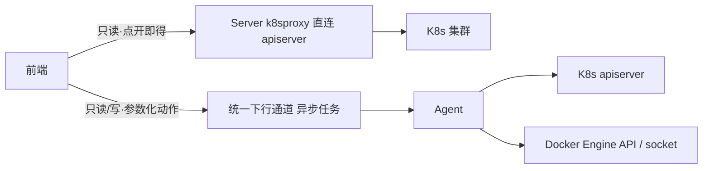

# 容器与工作负载管理面详细设计（信息架构重规划）

日期：2026-10-10
状态：**设计件（未实施）**。本批只产出规划，不改任何代码。
上位文档：`2026-09-30-ops-platform-evolution-design.md`（总体设计）、`2026-09-30-ops-platform-capability-map.md`（功能全景对照表 §3.8）
决策记录：`docs/adr/0003-container-management-downlink.md`（异步下行）、`docs/adr/0004-k8s-live-proxy.md`（Server 侧实时只读代理）、`docs/adr/0005-docker-management-channel.md`（本批新增）
相关设计件：`2026-09-30-container-observability-design.md`（D3，容器只读管理面）、`2026-10-04-container-inventory-design.md`（容器/工作负载台账清单）

## 意图与边界

**意图**（一条主线，两个菜单）：

把「由 Agent 采集、进时序库的**指标**」与「需要额外查询/下发才能得到的**对象事实与操作**」彻底分开，各自只留一个归属：

1. **中间件监控 → Kubernetes / Docker Tab**：只做**指标展示**——聚合计数与用量曲线，粒度到「集群 / 节点 / 主机」；对象级明细一律移除，只留跳转入口。
2. **容器与工作负载**：做**对象级管理**——覆盖 Kubernetes 与 Docker 两个平台；K8s 在既有只读面上新增排障写操作，Docker 从零建立管理面。

**边界**：

- **不提供任意命令 / 终端**。所有管理能力都是**参数化动作**（动作白名单 + 参数正则校验），这是平台操作面的既定上限（2026-10-05 用户拍板），本设计不打开这条口子。`container.exec` 仍为 P2、需独立评估。
- **凭据边界不放松**。K8s 凭据只在 Agent 本地（`k8sInstances`）或 Server 侧只读代理配置（ADR-0004）两处，**新增写操作只走 Agent 异步下行**，Server 代理保持只读、白名单不外扩。Docker 的 socket / daemon 地址只在 Agent 本机或可达网段，**没有 Server 直连等价通路**。
- **写操作另设本机护栏**。Docker 写操作不复用 `guards.ops.container`，按「同意的性质」另设 `guards.ops.docker`（与 `file` 独立于 `ops.write/units` 同一个取向）。
- **本批只出文档**。评审通过后再按 §九 分批实施。

## 现状与依据

| 事实 | 依据 |
|---|---|
| 两个菜单各自独立 | `web/src/router/index.js:32`（middleware，`middleware:read`）、`:36`（container，`container:read`）；`web/src/components/Sidebar.vue:169,171` |
| 中间件 K8s Tab 是「指标 + 对象明细」混合 | `web/src/components/k8s/K8sTab.vue`：KPI 第 25-44 行、集群卡片第 47-81 行、节点列表第 84-104 行、**异常 Pod 明细第 107-124 行**；接口 `GET /api/v1/middleware/k8s/instances`（第 190 行） |
| 中间件 Docker Tab 也是混合 | `web/src/components/docker/DockerTab.vue`：KPI 第 24-43 行、实例拓扑第 45-62 行、**容器列表第 64-116 行 + 详情抽屉第 119-152 行**；接口 `GET /api/v1/middleware/docker/containers`（第 233 行）、趋势 `GET /api/v1/query/range`（第 286-288 行） |
| 容器页只有 K8s、无 Docker | `web/src/components/container/ContainerView.vue`；4 个 Tab（第 290-296 行）为 `container.workloads` / `container.pods` / `container.events` / 实时清单（Server 代理） |
| 动作目录是新增动作的唯一入口 | `internal/server/ops/catalog.go:96-193`；kind 字面量统一定义在 `internal/model/ops.go:26-47`（Server 与 Agent 共用，不能各写一份） |
| **容器分组被守卫断言为「不得含写动作」** | `internal/server/ops/catalog_test.go:269-299` `TestCatalog_ContainerGroupIsReadOnlyAndGroupOrderStable`：容器分组内不得出现写动作、每个动作的 `Group` 必须在 `groupOrder` 声明 |
| 本机护栏结构 | `internal/agent/config/config.go:99-123` `OpsGuards{ReadOnly *bool, Write bool, Units []string, Container *bool, File OpsFileGuards}`；`OpsContainerEnabled()` `:174-176`（默认放行）；**无任何 docker 字段** |
| 能力协商只列「本机放行」的动作 | `internal/agent/ops/executor.go:85-106` `Supported()`；上报装配 `cmd/agent/main.go:454-461`（`Capabilities.Ops`） |
| K8s 实时代理是纯 GET | `internal/server/k8sproxy/k8sproxy.go:155-188`（唯一外呼 `GetJSON`，`http.MethodGet`）；白名单 `internal/server/api/k8s_live.go:23-28`（pods/deployments/events/nodes） |
| Docker 采集是纯只读，且已具备管理所需的端点雏形 | `internal/agent/collector/docker.go`：`GET /containers/json?all=true`（`:252-263`）、`GET /images/json`（`:265-276`）、`GET /containers/{id}/stats?stream=false`（`:278-289`）；全文件无 POST/DELETE |
| Docker 实例配置 | `internal/model/metric.go:530-533` `DockerInstanceConfig{Name, Addr}`（`Addr` 形如 `unix:///var/run/docker.sock` 或 `tcp://host:2375`）；`internal/agent/config/config.go:46` |
| 权限点目录 | `internal/server/auth/model.go:355-391`；「容器」域当前只有 `container:read`（`:384-387`） |
| 高风险权限点实际 11 项 | `internal/server/auth/policy.go:187-206`；**注意** `docs/guides/permission-matrix.md:37,434` 仍写「8 个 / `policy.go:71`」，是 1.25.0 基线快照，已过期，本批一并更正 |
| 权限点覆盖守卫 | `internal/server/auth/catalog_test.go:119-138` `TestEveryCatalogKeyIsGrantedBySomeRole`（每个权限点必须有非超管内置角色覆盖，例外须进 `superAdminOnlyKeys`） |
| 视图开关（Tab 显隐） | `internal/server/api/middleware_view_api.go` + `internal/server/mwview/store.go`；路由 `internal/server/api/query.go:298-301` |
| 术语现状 | `CONTEXT.md:127-159`（工作负载 / 容器 / 短命资产 / 下行操作 / 高危操作护栏 / **容器只读管理面**） |

## 一、职责定界

### 1.1 定界规则（一句话可判定）

> **中间件 Tab 回答「有多少 / 用了多少」（聚合计数与用量，维度止于集群 / 节点 / 主机）；
> 容器与工作负载回答「是哪个 / 它怎么样 / 对它做什么」（对象事实与操作，粒度到工作负载 / Pod / 容器 / 镜像）。**

推论（用于判断边界上的争议项）：

- 一个数字若**在时序库里有对应指标**且**不需要再查一次对象**就能算出来 → 归指标面。
- 一条信息若**包含对象标识**（对象名、命名空间、容器 ID、重启次数、原因）→ 归对象面，**哪怕它的数据源是指标**（例如「异常 Pod 明细」：计数是指标，明细是对象事实）。
- 一个按钮若会**改变被管理对象的状态** → 只能出现在容器与工作负载，且必须是参数化动作。

### 1.2 定界表

**A. 指标面（留在「中间件监控」）**

| 功能点 | 数据源 | 权限点 | 现状 | 目标 |
|---|---|---|---|---|
| K8s 集群健康（集群数、版本、在线） | 时序库 `k8s_cluster_up` + `instancereg` | `middleware:read` | K8sTab 集群卡片 | 保留（纯展示） |
| K8s 节点就绪 / 总数 | 时序库 `k8s_node_*` | `middleware:read` | K8sTab KPI | 保留 |
| K8s 节点 CPU / 内存用量 | 时序库 `k8s_node_cpu_usage_cores` / `k8s_node_mem_usage_bytes` | `middleware:read` | K8sTab 节点列表 | 保留（指标按节点展开，见 §1.4 争议项①） |
| Pod 运行 / 总数 / 异常计数 | 时序库 `k8s_pods_running` / `k8s_pods_abnormal` | `middleware:read` | K8sTab KPI | 保留 |
| 不健康工作负载计数 | 时序库 | `middleware:read` | K8sTab KPI | 保留 |
| Docker 主机 / 容器 / 镜像计数 | 时序库 `docker_*` | `middleware:read` | DockerTab KPI | 保留 |
| Docker 实例拓扑（按主机聚合计数） | 时序库 | `middleware:read` | DockerTab 实例拓扑 | 保留（聚合口径，不含容器明细） |
| **K8s 异常 Pod 明细** | 时序库即时查询 | `middleware:read` | K8sTab 第 107-124 行 | **移除**，改为跳转 |
| **Docker 容器列表 + 详情抽屉** | 时序库 + `/query/range` 趋势 | `middleware:read` | DockerTab 第 64-152 行 | **移除**，改为跳转 |

**B. 对象面（收敛到「容器与工作负载」）**

| 功能点 | 数据源 | 权限点 | 现状 | 目标 |
|---|---|---|---|---|
| K8s 可选集群清单 | `GET /api/v1/container/k8s/clusters` | `container:read` | 容器页 | 保留为管理面唯一「集群选择器」来源 |
| 工作负载列表 / 详情 | 异步 `container.workloads` / `container.describe` | `container:read` | 容器页 | 保留 |
| Pod 列表 / 详情 | 异步 `container.pods` / `container.describe` | `container:read` | 容器页 | 保留 |
| 事件 | 异步 `container.events` | `container:read` | 容器页 | 保留 |
| 实时清单 | Server 代理 `k8s_live`（只读白名单） | `container:read` | 容器页 | 保留（白名单不外扩） |
| Pod 日志（按需） | 异步 `container.logs` | `container:read` | 容器页 | 保留 |
| **重启工作负载 / 扩缩容 / 删除 Pod** | 新增 `container.restart` / `container.scale` / `container.delete` | **`container:write`（新）** | 无 | 新增（§四） |
| **Docker 引擎概览** | 新增 `docker.info` | **`docker:read`（新）** | 无 | 新增 |
| **Docker 容器列表（实时态）** | 新增 `docker.containers` | `docker:read` | 无 | 新增 |
| **Docker 容器详情 inspect** | 新增 `docker.inspect`（白名单投影） | `docker:read` | 无 | 新增 |
| **Docker 容器日志** | 新增 `docker.logs` | `docker:read` | 无 | 新增 |
| **Docker 容器启停 / 重启 / 删除** | 新增 `docker.start` / `docker.stop` / `docker.restart` / `docker.rm` | **`docker:write`（新）** | 无 | 新增 |
| **Docker 镜像列表 / 删除** | 新增 `docker.images` / `docker.image.rm` | `docker:read` / `docker:write` | 无 | 新增 |

### 1.3 中间件 Tab 收窄清单（逐块）

**`web/src/components/k8s/K8sTab.vue`**

| 块 | 行号 | 处置 | 说明 |
|---|---|---|---|
| 页头「展示类型开关」 | — | 保留 | 由 `middleware/view-config` 控制 |
| KPI 卡 | 25-44 | 保留 | 「异常 Pod」卡改为**可点击**，跳容器与工作负载并带上集群/命名空间预筛 |
| 集群卡片 | 47-81 | 保留 | 纯指标（版本、节点/Pod 计数、异常数） |
| 节点列表 | 84-104 | 保留 | 指标按节点展开（CPU/内存用量）；见 §1.4 争议项① |
| **异常 Pod 明细** | 107-124 | **移除** | 对象事实（Pod 名、命名空间、原因、重启次数）；移除后由 KPI 卡跳转承接 |
| 页头「进入容器与工作负载」 | — | **新增** | 跳 `/container`（按当前集群预筛） |

**`web/src/components/docker/DockerTab.vue`**

| 块 | 行号 | 处置 | 说明 |
|---|---|---|---|
| KPI 卡 | 24-43 | 保留 | 主机总数 / 在线 / 容器总数 / 运行中 / 已停止 / 镜像数 |
| 实例拓扑（按主机） | 45-62 | 保留 | 聚合口径；卡片上可加「进入 Docker 管理」入口 |
| **容器列表** | 64-116 | **移除** | 对象事实（容器名、镜像、状态、CPU/内存），改由 Docker 管理面承接 |
| **容器详情抽屉** | 119-152 | **移除** | 含 `GET /api/v1/query/range` 趋势调用（第 286-288 行），一并从该页移除 |
| 页头「进入容器与工作负载 → Docker」 | — | **新增** | 跳 `/container`（切到 Docker 平台） |

> 移除后，`DockerTab.vue` 不再调用 `GET /api/v1/middleware/docker/containers` 的明细字段与 `/query/range`；接口本身**保留不动**（它同时供总览与其它消费方，且是 `middleware:read` 的指标视图）。是否精简其响应字段留待实施时评估，本设计不主张改接口。

### 1.4 重叠消解与三处争议项

**消解①：集群清单两条接口——保留，但明确职责（刻意不合并）。**

`internal/server/api/container_api.go:handleContainerClusters` 与 `internal/server/api/middleware_api.go:handleK8sInstances` 同源（都读 `instancereg` 的 `K8sInstance` + `k8s_cluster_up`），看起来是重复。**结论：不合并。** 理由：

- 两条接口的**权限点不同**（`container:read` vs `middleware:read`）。合并成一条会让「能看指标的人」或「能管容器的人」之一失去入口，或者被迫扩大权限——这正好违反本设计的定界初衷。
- 两条接口的**最小视图不同**：管理面只需要「可选集群名 + 在线」，指标面需要「节点/Pod/工作负载计数」。合一条会让指标页依赖管理面接口，或反之。

**要写进注释/文档的是「同源不冗余」**，避免以后有人以「去重」为名把它们合并掉。

**消解②：Pod 视图两处——中间件侧只留计数，对象入口唯一。**

移除 K8sTab 的异常 Pod 明细后，「看某个 Pod」的唯一入口是容器与工作负载。KPI 上的计数卡保留并作为**下钻入口**（点计数 → 跳到管理页并按集群/命名空间预筛），这样「先看有没有异常、再看是哪个」的动线仍然顺畅。

**消解③：集群/节点视角——两处都保留，但信息面不同。**

中间件 K8s Tab 的节点列表是**指标维度展开**（CPU/内存用量）；容器页的实时 `nodes` 是**管理面对象视图**（实时态、可用于定位 Pod 落在哪台机器）。二者不冲突。

**争议项①：节点列表到底算不算「对象明细」？**

节点列表含节点名 / IP / 集群 / 角色 / 状态，看起来是对象事实。**判定为保留**，理由：这张表的**存在意义是承载 CPU/内存用量两列**（metrics-server 的数据源，见 `reference_dev_server_k8s.md` 的教训：裁掉 metrics-server 会让这两列静默显示 `-`），不是「管理节点」。定界规则里「指标按节点展开」明确允许它。**若将来要给它加操作按钮（cordon / drain），那必须移到管理面**——这条写进注释。

**争议项②：Docker 实例拓扑算不算对象明细？**

`DockerTab` 的实例拓扑按**主机**聚合（每主机一个卡片 + 容器计数），粒度止于主机，符合「维度止于主机」。**保留**。容器级的列表才移除。

**争议项③：Docker 容器数按主机 vs 容器列表。**

保留「按主机的容器计数」，移除「跨主机的容器明细列表」。二者粒度不同，前者是聚合，后者是对象。

## 二、「容器与工作负载」新信息架构

### 2.1 顶层结构

页面顶部为**平台切换**（Kubernetes / Docker），之下按「资源类型 → 对象 → 详情 / 事件 / 日志」组织，沿用既有抽屉、表格、「上次刷新」与「提交 → 轮询」约定，**不新建前端框架**。

```
容器与工作负载  [ Kubernetes | Docker ]
├─ Kubernetes
│   ├─ 集群选择 + 命名空间
│   ├─ 工作负载   列表 / 详情 / [重启] [扩缩容]
│   ├─ Pod        列表 / 详情 / [删除] / 日志
│   ├─ 事件
│   └─ 实时清单   （Server 只读代理）
└─ Docker
    ├─ 主机选择（Docker 引擎）
    ├─ 引擎概览   版本 / 容器与镜像计数 / 资源占用
    ├─ 容器       列表 / 详情 inspect / 日志 / [启停] [重启] [删除]
    └─ 镜像       列表 / [删除]
```

平台切换用**独立状态**（切到 Docker 不应丢掉 K8s 的查询结果）；`web/src/components/container/queryCache.js` 的跨路由保留语义沿用。

### 2.2 Kubernetes 侧

在既有 4 个 Tab 上新增写操作入口（按钮按权限门控 + 二次确认）：

| 操作 | 语义 | 对应动作 | 备注 |
|---|---|---|---|
| 重启工作负载 | `kubectl rollout restart` 等价 | `container.restart` | 参数：集群、命名空间、kind、名称 |
| 扩缩容 | 修改副本数 | `container.scale` | 参数：集群、命名空间、kind、名称、replicas（有上下限） |
| 删除 Pod | 删除单个 Pod（由控制器重建） | `container.delete` | 参数：集群、命名空间、Pod 名 |

**不做**：删除工作负载、删除命名空间、`kubectl exec`、任意 YAML apply/patch。删除工作负载是「不可逆的破坏」，与「排障」不是一类；`apply` 是任意配置写入，等价于绕过白名单。

### 2.3 Docker 侧（全新）

| 区域 | 能力 | 动作 |
|---|---|---|
| 主机选择 | 选择 Docker 引擎所在主机（来自 `DockerInstance` 的 `Node` / `Group`） | — |
| 引擎概览 | 版本、容器/镜像计数、CPU/内存占用、存储占用 | `docker.info` |
| 容器列表 | 状态、镜像、端口、启动时间（实时态） | `docker.containers` |
| 容器详情 | 白名单投影的 inspect（见 §4.3） | `docker.inspect` |
| 容器日志 | stdout/stderr 最近 N 行 | `docker.logs` |
| 容器启停 | start / stop / restart | `docker.start` / `docker.stop` / `docker.restart` |
| 容器删除 | 删除容器（默认不删卷，见 §八） | `docker.rm` |
| 镜像列表 | 仓库标签、大小、创建时间、悬空标记 | `docker.images` |
| 镜像删除 | 删除镜像（含悬空镜像批量清理） | `docker.image.rm` |

**实时态口径**：Docker 全部能力走异步下行（§3.3），因此「实时态」指**每次查询现拉**（而非 Server 直连的毫秒级）。界面必须显示「上次刷新」时间并支持手动刷新——沿用 `feedback_async_query_refresh` 的既有约定：**结果跨路由保留，只在无结果时自动查一次，其余手动刷新**。

## 三、数据通路



### 3.1 K8s 只读实时 → Server 代理（ADR-0004）

- 实现：`internal/server/k8sproxy/`（`GetJSON`，纯 GET）+ `internal/server/api/k8s_live.go`（白名单 pods/deployments/events/nodes）。
- 配置：运维在 Server 上手工维护 `<DataDir>/k8s-live.yaml`（含凭据，文件权限应 0600）。
- **本设计不扩白名单、不加写动词**。写操作走 §3.2。

### 3.2 K8s 写操作 → 异步下行（ADR-0003）

- 写操作需要**逐机护栏**（哪台机器愿意改集群）与**凭据边界**（凭据在 Agent 本地），因此只走统一下行通道（`POST /api/v1/ops/tasks` + 轮询）。
- 延迟约一个上报周期（默认 15s），界面语义与既有 `container.*` 只读动作一致。

### 3.3 Docker 全部能力 → 只能异步下行

- Docker socket / daemon 地址只在 Agent 本机或可达网段（`DockerInstanceConfig.Addr`），**不存在 Server 直连等价通路**（与 K8s 的关键差异）。
- 因此 Docker 的**只读查询也是异步的**：点开列表要等一个上报周期。这是必须写进界面文案的预期（「提交 → 轮询 → 上次刷新」）。
- **不新增 Server 侧 docker 代理**：那要求把 socket 暴露给 Server，等于把「能起容器」的能力搬到中心，与逐机护栏的取向相反。

## 四、动作清单与护栏

### 4.1 新增 kind 清单

kind 字面量统一加在 `internal/model/ops.go`（Server 与 Agent 共用），目录登记在 `internal/server/ops/catalog.go`，Agent 分派在 `internal/agent/ops/`。

| kind | 分组（建议） | 只读 | 所需域权限点 | 参数（正则/上限） |
|---|---|---|---|---|
| `container.restart` | 容器操作 | 否 | **`container:write`（仅超管）** | cluster、namespace、kind、name |
| `container.scale` | 容器操作 | 否 | **`container:write`（仅超管）** | cluster、namespace、kind、name、replicas（0 ~ 上限，整数） |
| `container.delete` | 容器操作 | 否 | **`container:write`（仅超管）** | cluster、namespace、pod |
| `docker.info` | Docker | 是 | `docker:read` | host |
| `docker.containers` | Docker | 是 | `docker:read` | host、all（可选） |
| `docker.inspect` | Docker | 是 | `docker:read` | host、id |
| `docker.logs` | Docker | 是 | `docker:read` | host、id、tail（默认 200 / 最多 500）、since（最多 24h） |
| `docker.start` | Docker 操作 | 否 | **`docker:write`（仅超管）** | host、id |
| `docker.stop` | Docker 操作 | 否 | **`docker:write`（仅超管）** | host、id、timeout（可选） |
| `docker.restart` | Docker 操作 | 否 | **`docker:write`（仅超管）** | host、id、timeout（可选） |
| `docker.rm` | Docker 操作 | 否 | **`docker:write`（仅超管）** | host、id、force（可选） |
| `docker.images` | Docker | 是 | `docker:read` | host、dangling（可选） |
| `docker.image.rm` | Docker 操作 | 否 | **`docker:write`（仅超管）** | host、id、force（可选） |

> 「所需域权限点」这一列就是 **D4** 的落地形态：它写在动作目录的 `Action` 上（见 §六），提交时统一校验——**新增动作只改目录一处**。

**分组命名与既有守卫冲突（必须处理）**：`catalog_test.go:269-299` 断言「容器分组内不得出现写动作」且 `Group` 必须在 `groupOrder` 中声明。因此：

- 只读 Docker 动作可归入新分组 `Docker`；
- 写动作（K8s 与 Docker）**另开分组**（如 `容器操作` / `Docker 操作`），并同步扩展 `internal/server/ops/catalog.go:217` 的 `groupOrder`；
- **不改** `TestCatalog_ContainerGroupIsReadOnlyAndGroupOrderStable` 的断言（它守的是「容器分组只读」这条既有承诺，改写等于放松护栏）。实施时若分组粒度与界面观感冲突，优先保守卫。

### 4.2 本机护栏

沿用四道护栏（本机护栏 → 能力协商 → 中心授权与审计 → 超时作废），新增一个独立开关：

```yaml
guards:
  ops:
    container: true        # 既有：容器/K8s 只读查询（三态 *bool，默认放行）
    docker:                # 新增：Docker 管理面（三态 *bool，默认放行只读）
      read: true
      write: false         # 默认关闭；开启后才放行 docker.start/stop/restart/rm/image.rm
```

- 语义对齐 `guards.ops.file{write,dirs}`：**「愿意交出集群结构」与「愿意被启停容器」是两件事**，不复用 `container` 开关。
- 三态：`nil` = 默认（只读放行、写关闭）；显式 `false` 整体关闭；`read: true` 只开只读。
- **能力协商**：`Supported()` 只列本机放行的动作（`internal/agent/ops/executor.go:85-106` 的既有做法）。未配 `dockerInstances` 或未放行的机器**不声明** `docker.*` 能力，界面显示「该节点未放行 / 不支持」，而不是下发一条注定失败的任务。

### 4.3 脱敏与上限

**`docker.inspect` 是白名单投影，不是原始 JSON**（与 `container.describe` 同一条道理：脱敏透出漏一个字段就是一次凭据泄露）：

| 字段类 | 处置 |
|---|---|
| 环境变量 | 只给**变量名**，不给值 |
| 挂载（Mounts / Binds） | 给宿主路径与容器路径，不给内容 |
| 网络（NetworkSettings） | 给网络名、IP、端口映射；不给完整 JSON |
| 标签 / 注解 | 白名单键（`com.docker.compose.*` 等），其余略过 |
| `Config.Env` / `Config.Labels` 中的凭据类键 | 一律占位符 |
| `Config.Image` / `Image` | 给（排障必需） |

**`docker.logs`**：行数默认 200 / 最多 500，时间窗最多 24h，单次正文预算与 `container.logs` 同口径（96 KiB），超出即截断并显式标注；**不提供全量下载**（与 `container.logs` 一致：要看全量应上机器或走日志后端）。

### 4.4 结果形态

复用 `model.ContainerQueryResult`（列名 + 行的通用表格形态，`internal/model/ops.go:192-206`）承载 `docker.containers` / `docker.images` / `docker.info`；`docker.inspect` 用 `OpsResult.JSON`（结构化载荷）。

## 五、权限点与角色

### 5.1 新增权限点

| 域 | 权限点 | 说明 | 授予 |
|---|---|---|---|
| 容器 | `container:write` | K8s 排障写操作：重启工作负载 / 扩缩容 / **删除 Pod** | **仅超管**（`superAdminOnlyKeys`） |
| 容器 | `docker:read` | Docker 管理面只读（引擎概览 / 容器列表 / 详情 / 日志 / 镜像列表） | 运维管理员 |
| 容器 | `docker:write` | Docker 写操作（启停 / 重启 / 删除容器、删除镜像） | **仅超管**（`superAdminOnlyKeys`） |

**为什么 K8s 三项写操作合成一个权限点（而不是拆成两个）**：初稿曾把「删除 Pod」单列，理由是重启/扩缩容有控制器兜底、删除没有。用户 2026-10-10 拍板**三项全部只给超管**之后，这个拆分就不再表达任何差异——两个权限点会**永远同时授予**（只有超管有），等于一个权限点加一份噪声。**权限点的价值在于能表达一个独立的授权判断**，表达不了就该合并。若将来出现「让运维管理员能重启、但只有超管能删」的真实诉求，那时再拆（改动很小：加一个权限点 + 两处登记）。

**为什么不把 Docker 并进 `container:read`**：Docker 管理面读的是**本机（或可达网段）的容器运行时**，K8s 管理面读的是**集群内部对象**——两者的授权面不同（一台机器可能只跑 Docker 不接集群，反之亦然）。这延续 `container:read` 与 `middleware:read` 分开的同一取舍。

### 5.2 高风险与双人复核（已定）

- 两个**写**权限点（`container:write` / `docker:write`）均**改变被管理对象的状态**，**并入 `HighRiskPermissions`**（`internal/server/auth/policy.go:187-206`）。`docker:read` 是只读，不入。
- **双人复核（D1）：不纳入**（用户 2026-10-10 拍板）。与 `ops:exec` 当前口径一致——`IsHighRisk` 目前是**声明式标记**（不额外拦截），待审批链路真正拦截后再统一收口。因此本设计的门控是「权限点 + 本机护栏 + 界面二次确认 + 审计」四件，**不依赖审批链路**。

### 5.3 内置角色授予（已定）

必须满足 `TestEveryCatalogKeyIsGrantedBySomeRole`（`internal/server/auth/catalog_test.go:119-138`）：每个权限点都要有**非超管**内置角色覆盖，否则必须进 `superAdminOnlyKeys` 并注明理由。

| 权限点 | 授予 | 依据 |
|---|---|---|
| `container:write` | **仅超管**（进 `superAdminOnlyKeys`） | 用户 2026-10-10 拍板：K8s 三项写操作（重启工作负载 / 扩缩容 / 删除 Pod）全部只给超管 |
| `docker:read` | 运维管理员 | 只读，与 `container:read` / `logs:read` 同一取舍 |
| `docker:write` | **仅超管**（进 `superAdminOnlyKeys`） | 用户 2026-10-10 拍板：启停 / 删除容器与删除镜像直接改变本机运行态 |

**刻意不给只读 / 告警 / 安全 / 审计角色**：与 `container:read` / `logs:read` / `ops:exec` 的既有取舍一致。

**与既有取舍的一处刻意偏离（实施时写进注释）**：两个写权限点**都没有**沿用「给运维管理员、靠本机护栏兜底」这条对 `ops:exec` 的惯例——用户明确要求只给超管。含义是**两道门独立**：即使目标机器的 `guards.ops.docker.write` / `guards.ops.container` 已放行，运维管理员也下不了这些动作（权限点先拦）；反过来超管下发了，仍需那台机器自己放行。若将来运维反馈「重启容器/工作负载也得用超管账号」成为负担，再评估放宽（改动只在 `BuiltinRoles()` 与 `superAdminOnlyKeys` 两处）。

## 六、接口草案

```
# 管理面（新增；既有接口不动）
GET    /api/v1/container/k8s/clusters          # 既有：K8s 可选集群清单（container:read）
GET    /api/v1/container/k8s/live-configs      # 既有：实时查询可用集群（container:read）
GET    /api/v1/container/k8s/live/{cluster}/{resource}   # 既有：只读白名单代理
GET    /api/v1/container/docker/hosts          # 新增：Docker 可选主机清单（docker:read）
POST   /api/v1/ops/tasks                       # 既有：提交动作（container:write / docker:write 由 kind 判定）
GET    /api/v1/ops/tasks/{id}                  # 既有：查询任务
POST   /api/v1/ops/tasks/cancel                # 既有：撤回（仅 queued）
```

**权限点如何按 kind 判定（D4，已定）**：`POST /ops/tasks` 的既有入口权限点是 `ops:exec`。本设计**不改变**这条通道的入口权限（改它会波及全部动作），而是在**动作目录的 `Action` 结构体上增加 `Perm` 字段**——每个动作自带「除 `ops:exec` 之外还需要哪个域权限点」，提交时统一校验：

- `container.restart` / `container.scale` / `container.delete` → `container:write`（仅超管）
- `docker.*` 只读 → `docker:read`
- `docker.*` 写 → `docker:write`（仅超管）

**D4 到底在问什么、三种做法对比**（问的是「服务端在哪一步知道『这个动作需要哪个域权限点』」）：

| 做法 | 结论 |
|---|---|
| **在动作目录的 `Action` 上加 `Perm` 字段**（选定） | 「新增动作只改目录一处」这条既有承诺继续成立（现在新增动作确实只改目录 + Agent 实现）。权限点与动作定义在同一个地方，不会漂移 |
| 在 ops handler 里再写一份 `kind → 权限点` 映射表 | 同一件事两处定义；将来新增动作容易只改目录、漏改映射表，而**漏改的症状是「权限没校验」**——静默放大权限，是最危险的一类遗漏 |
| 给每个动作单开路由 / 单列权限点 | 路由爆炸（13 个新动作），且要重做前端调用与能力协商，收益不成比例 |

## 七、前端与菜单

- **菜单不动**：「容器与工作负载」仍是「观测监控」分组下的一项（`Sidebar.vue:171`），命令面板入口不变。
- **中间件 Tab 加跳转**：`K8sTab.vue` / `DockerTab.vue` 页头新增「进入容器与工作负载」按钮（分别带 `?platform=k8s` / `?platform=docker` 预筛）。
- **容器页加平台切换**：`ContainerView.vue` 顶部新增 `Kubernetes | Docker` 切换，Docker 面板新建组件（建议 `web/src/components/container/DockerPanel.vue`，与 K8s 面板并列，避免 `ContainerView.vue` 继续膨胀）。
- **按权限隐藏**：写操作按钮按权限点门控——K8s 三项写操作（重启工作负载 / 扩缩容 / 删除 Pod）按 `container:write`、Docker 写按 `docker:write`；无权时不渲染按钮（服务端仍是安全边界）。两项都是**超管专属**，在非超管账号下**完全不出现**（含置灰的「无权限」提示也不给，避免把入口当成待办）。
- **Docker 面板的空态**：未配 `dockerInstances` 的机器不出现在主机列表；界面提示「该节点未开启 Docker 管理」而不是空表格。

## 八、风险与取舍

| 风险 | 取舍 |
|---|---|
| Docker 全部走异步，点开列表要等一个上报周期 | 明确定义为异步语义，界面显示「上次刷新」+ 手动刷新；不做「假装实时」的轮询轰炸 |
| 写操作误删容器 / 误删镜像 | 写动作默认被本机护栏挡下（`guards.ops.docker.write` 默认 false）；界面二次确认；`docker.rm` 默认**不删卷**（`-v` 需显式参数，本设计不提供）；`docker.image.rm` 默认不 `force` |
| 扩缩容把副本数改成 0（服务下线） | `container.scale` 的 `replicas` 参数设下限校验；界面提示「0 副本等于停止服务」并要求确认 |
| `docker.inspect` 泄露凭据 | 白名单投影 + 凭据类键占位；`docker.logs` 行数与预算硬上限 |
| 新增权限点漏授内置角色 | 由 `TestEveryCatalogKeyIsGrantedBySomeRole` 守卫兜住（`ops:read/ops:exec` 曾漏授，见 `docs/guides/permission-matrix.md:85-89`） |
| 容器分组写动作破坏既有守卫 | 写动作另开分组；**不改** `TestCatalog_ContainerGroupIsReadOnlyAndGroupOrderStable` |
| 有人以「去重」为名合并两条集群清单接口 | §1.4 消解① 写明「同源不冗余」的理由，并在两条 handler 的注释里交叉引用本设计件 |
| 把中间件 Tab 的节点列表也当对象面移除 | §1.4 争议项① 明确保留；若将来加 cordon/drain 按钮则必须迁到管理面 |

## 九、分批实施与验收口径

| 批次 | 内容 | 验收口径（建议） |
|---|---|---|
| **A** | Docker **只读**管理面：`docker.info/containers/inspect/logs/images` + 护栏 `guards.ops.docker.read` + 权限点 `docker:read` + 容器页平台切换与 Docker 面板 | 未配 `dockerInstances` 的机器不声明能力、界面显示「未开启」；inspect 白名单投影用真值反向断言（env 值不出现）；logs 行数上限与截断标注 |
| **B** | Docker **写**操作：`docker.start/stop/restart/rm/image.rm` + `guards.ops.docker.write`（默认关闭）+ 权限点 `docker:write`（**仅超管**）+ 二次确认 | 未开写护栏时任务被拒且文案指向 `agent.yaml`；`docker.rm` 不删卷；审计留痕；写动作排在只读之后；**非超管提交一律 403**（即使本机已放行） |
| **C** | K8s **写**操作：`container.restart/scale/delete` + 新分组 + `container:write`（**仅超管**，三项共用）+ 二次确认 | 扩缩容下限校验；删除 Pod 后由控制器重建；`groupOrder` 与守卫测试全绿；**运维管理员下三项写操作都得 403、超管可下发** |
| **D** | 中间件 Tab 收窄：移除异常 Pod 明细与 Docker 容器列表/详情，加跳转入口 | 两 Tab 不再有对象明细；跳转带上预筛；`DockerTab` 不再调 `/query/range`；组件用例覆盖跳转 |

**实施前置（跨批通用）**：

- 新增动作后必须同步：`internal/model/ops.go`（kind 常量）→ `internal/server/ops/catalog.go`（目录 + `groupOrder`）→ `internal/agent/ops/executor.go`（`Supported()` + 分派）→ Agent 侧实现。**Agent 改动必须与 Server 同步升级并重分发**（否则不声明能力，界面显示「未放行」）。
- 权限点新增后必须同步 `auth.PermissionCatalog()` 与 `auth.BuiltinRoles()` 两处。
- 涉及落盘 / socket 的 Agent 改动，验证要在 Linux 上跑（Windows 会跳过 POSIX 路径用例），用 dev-server（见 `reference_dev_server_k8s.md` / `reference_devserver_mw_test.md`）。

## 十、实施记录（按批次追加）

### 设计件（2026-10-10）

本批为**信息架构重规划**，只产出本文档与配套修订（D3 设计件对齐、能力全景表 §3.8 补行、权限矩阵更正、`CONTEXT.md` 术语更新、ADR-0005）。**未改任何代码**。

**四个决策点已由用户 2026-10-10 拍板**：

| 决策点 | 结论 | 落点 |
|---|---|---|
| **D1** 写操作是否进双人复核 | **不进**——与 `ops:exec` 现状一致（审批链路目前是声明式、零拦截） | §5.2 |
| **D2** 删除 Pod 的门控强度 | **K8s 三项写操作（重启工作负载 / 扩缩容 / 删除 Pod）全部仅超管**；原拟单列的 `container:delete` 因此**合回 `container:write`**（两个永远同时授予的权限点等于一个加一份噪声） | §5.1、§5.3 |
| **D3** `docker:write` 是否只给超管 | **只给超管**（覆盖了「给运维管理员 + 本机护栏兜底」的初版倾向） | §5.3 |
| **D4** 按 kind 叠加域权限点的落点 | **在动作目录的 `Action` 上加 `Perm` 字段**（不在 handler 里维护第二份映射） | §4.1、§六 |

**待评审：无**（四个决策点已定）。实施前只需确认 §九 的分批顺序与 A/B/C/D 四批的边界。
